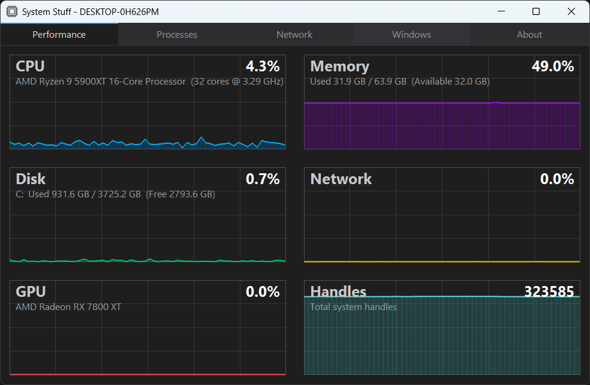

# SysMate

[](https://github.com/ZacWalk/sys-mate/actions/workflows/build.yml)

A lightweight Windows system information utility built on the libdesktop
platform layer. Uses 10% of the memory task manager uses.

Way back around 2000, the company I worked for still supported Windows 95 and 98 for the desktop application we sold. I typically volunteered to test on those platforms and had written my own task manager like program. Every 5 years or so I get it building and do a few updates. It started out as SysMate, went by System Stuff for a while, and is SysMate again.



## Features

- **Performance** — real-time charts for CPU, memory, disk, network, GPU and
  handle counts, with a 60-sample scrolling history updated every second.
  Network and handle charts auto-scale against the peak seen, and throughput is
  reported in real units rather than a percentage of an arbitrary ceiling.
- **Processes** — name, PID and working-set memory via Toolhelp32, with the
  module list for the selected process. Show in Explorer or kill from the
  context menu.
- **Network** — active TCP and UDP connections over IPv4 and IPv6 via the IP
  Helper API, with protocol, addresses, state and owning process.
- **Windows** — visible top-level windows with title, class, PID and handle, plus
  a detail pane showing rect, size and styles.
- **About** — OS build, architecture, processor, GPU, RAM, system drive and
  uptime, copyable to the clipboard in one action.

Every list sorts by clicking a column header, filters as you type on the text of
any column, and is fully keyboard accessible. The UI is per-monitor DPI aware and
rescales when dragged between monitors.

<kbd>F5</kbd> refreshes, <kbd>Ctrl</kbd>+<kbd>F</kbd> focuses the filter box, and
<kbd>Ctrl</kbd>+<kbd>1</kbd>–<kbd>5</kbd> jump between tabs.

## Building

Requires Windows x64 and Visual Studio with the Desktop C++ workload. The
application uses the published
[libdesktop](https://github.com/ZacWalk/libdesktop) C++20 platform layer; a
sibling `..\libdesktop` checkout is used automatically during local builds.
The vendored [dd](https://github.com/ZacWalk/dd) runtime locates Visual Studio
and uses the CMake and Ninja that ship with it.

```powershell
.\dd.ps1 build        # both configurations
.\dd.ps1 test --label sys-mate # build and run the headless suite
.\dd.ps1 launch       # build Release, then start the app
```

Binaries land in `exe\` as `sys-mate-64.exe`, with a `d` suffix for Debug.

The test label runs seven headless unit programs in both Debug and Release:
the build smoke check, the table sort regression, the UI model
layout/filter/selection/focus checks, the native monitoring smoke check, and
UTF-8 filter input checks, plus an offscreen reactor lifecycle/selection run.
The UI entry also drives the production list/filter/focus reactors with
deterministic rows and recorded drawing; it does not show a window.

## Documentation

[AGENTS.md](AGENTS.md) — conventions for contributors and coding agents.

## License

MIT — see [LICENSE](LICENSE).

Copyright (c) 2002+ Zac Walker
